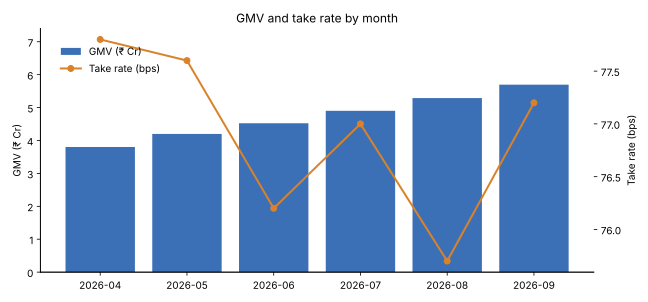
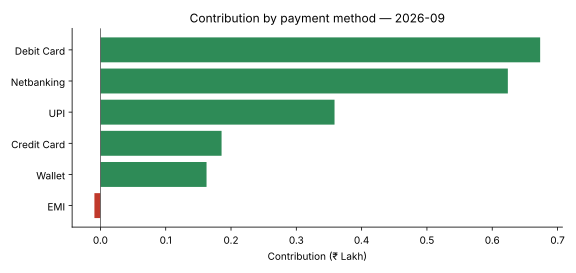

# Automated Finance MIS Reporting with SQL, Python & Claude

An end-to-end pipeline that turns raw payment-gateway data into a **monthly Business Finance MIS report**: validated data, a SQL KPI layer, an Excel workbook with native charts, and **AI-written CFO commentary from Claude that is automatically fact-checked** against the source numbers.

It runs on a schedule with GitHub Actions, so the report builds itself on the 1st of every month with no manual work.

> Built to mirror the work of a Data Analyst in a fintech Business Finance team: automated business reports, data accuracy, and AI-powered process automation.

---

## Why this project

Finance teams at payment companies spend days every month pulling numbers, cleaning them, pasting them into Excel and writing commentary. This project automates the whole loop while keeping a finance-grade standard of accuracy:

| Manual process | This pipeline |
|---|---|
| Copy-paste exports into Excel | SQL KPI layer feeds a formatted workbook directly |
| Bad rows silently skew totals | 11 data-quality checks; bad rows quarantined with a reason, never silently dropped |
| Analyst writes commentary from scratch | Claude drafts the commentary from aggregated KPIs |
| Hope the commentary numbers are right | Every number Claude writes is traced back to the KPI layer; untraceable figures are flagged |
| Someone remembers to run it | GitHub Actions runs it monthly and uploads the report |

## Architecture

```
data/raw/*.csv
   │  (payments, merchants, refunds)
   ▼
src/quality_checks.py ── 11 checks ──► dq_quarantine + dq_log
   │  clean rows                         (control totals must tie out
   ▼                                      or the run stops)
SQLite warehouse (data/warehouse.db)
   │
   ▼
sql/kpi_queries.sql ── 7 named queries (CTEs, window functions, cohorts)
   │
   ├──► src/ai_commentary.py ── Claude ──► number verification
   │
   ▼
reports/finance_mis_YYYY-MM.xlsx   (9 formatted sheets + native Excel charts)
reports/finance_mis_YYYY-MM.md     (summary + charts + DQ log)
```

## What the report contains

**KPIs** (definitions are documented at the top of [`sql/kpi_queries.sql`](sql/kpi_queries.sql)):

- **Monthly P&L:** GMV, refunds, net GMV, gross revenue (MDR), network cost, contribution, contribution margin, take rate (bps), payment success rate, active merchants, average ticket, MoM growth (via `LAG()`)
- **Payment-method economics:** success rate, GMV share and contribution by UPI / cards / netbanking / wallet / EMI
- **Segment view:** Enterprise vs Mid-Market vs SMB with MoM growth
- **Top 15 merchants** by contribution with rank movement vs last month (`RANK()` window function)
- **At-risk merchants:** early-warning list of merchants whose GMV dropped more than 40% MoM
- **Category trend** (pivoted) and **merchant cohort retention**
- **Data-quality log** with PASS / WARN / FAIL status, colour-coded in Excel

**Sample output (September 2026, synthetic data):**

| Metric | Value |
|---|---|
| GMV | ₹5.70 Cr (+7.7% MoM) |
| Gross revenue | ₹4.40 L (+9.9% MoM) |
| Contribution | ₹1.99 L (45.4% margin) |
| Take rate | 77.2 bps |
| Payment success rate | 90.05% |
| Rows quarantined by DQ checks | 152 of 146,026 |





**Insight surfaced:** EMI is the only payment method with *negative* contribution. Its network cost exceeds the MDR earned, which is a pricing conversation for the finance team.

Full sample report: [`reports/finance_mis_2026-09.md`](reports/finance_mis_2026-09.md)

## Making AI output safe for finance

LLMs can invent numbers. In a finance report that's unacceptable, so the Claude integration has four guardrails:

1. **Aggregates only.** Claude sees a small JSON of KPIs, never transaction-level or merchant data.
2. **Constrained prompt.** Claude is told to use only numbers present in the facts and to copy currency values verbatim.
3. **Automated fact-check.** `verify_numbers()` extracts every number from Claude's text and checks it against the facts sheet. Anything untraceable is printed at the top of the report for the reviewer.
4. **Graceful fallback.** With no API key, or if the API call fails, a deterministic rule-based commentary is used so the scheduled run never breaks.

## Data-quality checks

| # | Check | Severity | Action |
|---|---|---|---|
| 1 | Exact duplicate rows | blocking | Keep first, quarantine rest |
| 2 | `payment_id` conflicts | blocking | Quarantine for manual review |
| 3 | Missing amount | blocking | Quarantine |
| 4 | Zero / negative amount | blocking | Quarantine |
| 5 | Future-dated transaction | blocking | Quarantine (timezone / ETL bug) |
| 6 | Merchant not in master | blocking | Quarantine (onboarding sync) |
| 7 | MDR fee > 5% of amount | warning | Flag to pricing |
| 8 | Fee on non-captured payment | warning | Flag to billing |
| 9 | Refund on unknown / uncaptured payment | blocking | Exclude from net revenue |
| 10 | Refund > captured amount | blocking | Exclude, escalate |
| 11 | **Control total:** input rows = clean + quarantined | blocking | **Stop the run** if it doesn't tie out |

## Quick start

```bash
git clone https://github.com/Abhi1803-hash/Finance-MIS-Report-Automation.git
cd Finance-MIS-Report-Automation
pip install -r requirements.txt

python src/generate_data.py              # ~146k synthetic payments, 6 months, 1,200 merchants
python -m src.pipeline --month 2026-09   # builds reports/ in about 4 seconds

# optional: AI commentary from Claude
export ANTHROPIC_API_KEY=sk-ant-...
python -m src.pipeline --month 2026-09

python -m pytest -q                      # 5 tests: DQ rules, control totals, fact-checker
```

## Automation

[`.github/workflows/monthly_report.yml`](.github/workflows/monthly_report.yml) runs the pipeline at 09:00 IST on the 1st of every month for the month just closed, runs the tests first, and uploads the Excel and Markdown report as a downloadable build artifact. Add `ANTHROPIC_API_KEY` as a repository secret to switch on Claude commentary.

## Project structure

```
├── src/
│   ├── generate_data.py     # synthetic payments, merchants, refunds (+ injected DQ issues)
│   ├── quality_checks.py    # validation layer, quarantine, control totals
│   ├── ai_commentary.py     # Claude commentary + number verification + fallback
│   └── pipeline.py          # orchestration, SQLite load, Excel/Markdown/chart output
├── sql/kpi_queries.sql      # 7 named KPI queries
├── tests/test_pipeline.py
├── reports/                 # sample output
└── .github/workflows/monthly_report.yml
```

## Tech stack

**SQL** (SQLite; CTEs, window functions, cohort analysis) · **Python** (pandas, NumPy, openpyxl, matplotlib) · **Claude API** (Anthropic SDK) · **Excel** reporting · **GitHub Actions** · pytest

## About the data

All data is **synthetic**, generated by `src/generate_data.py` with a fixed seed so results are reproducible. Volumes are scaled down to run on a laptop. The pricing structure (zero-MDR UPI, card MDR by segment, network costs by method, 18% GST on fees) is modelled on how Indian payment gateways work, but no real company's data is used.
